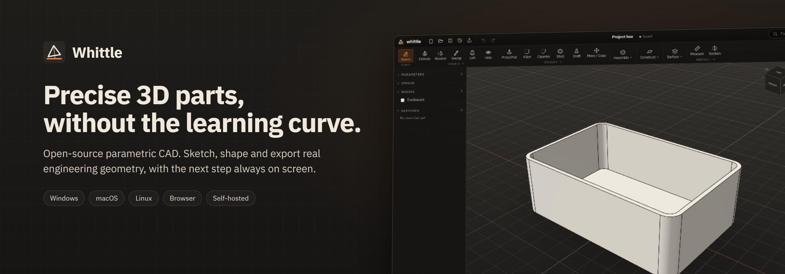
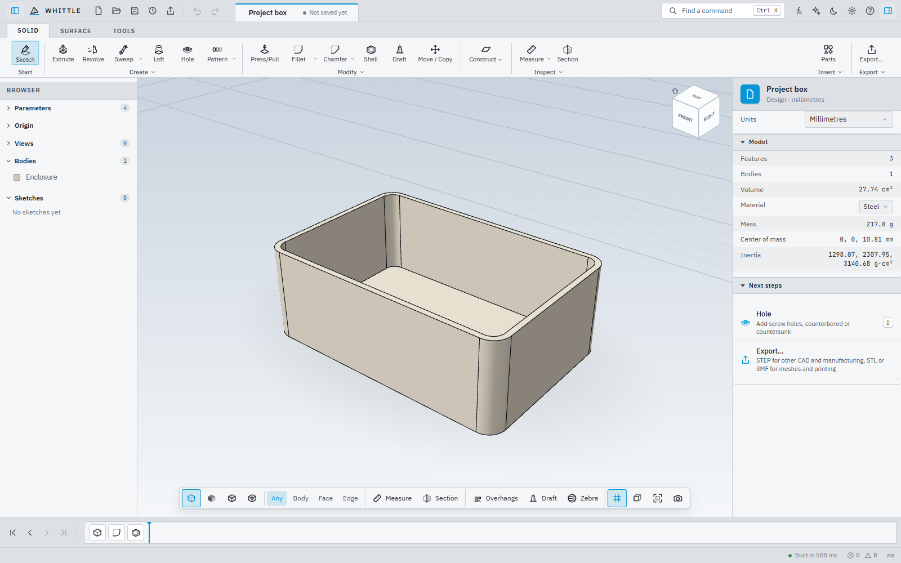
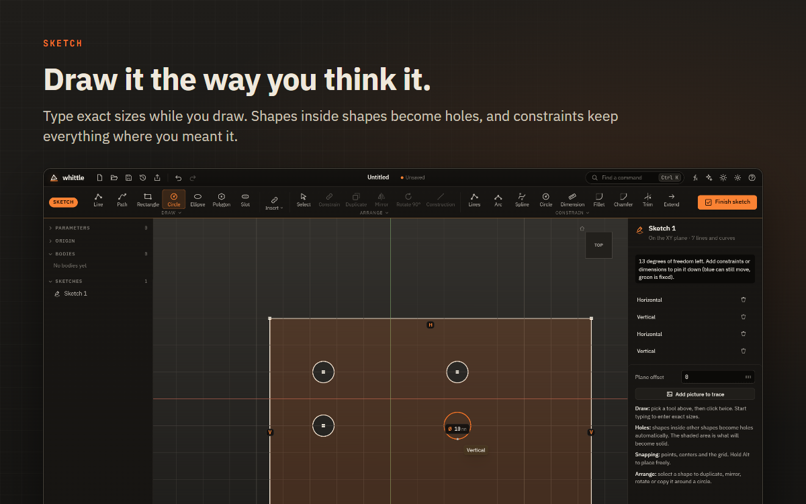
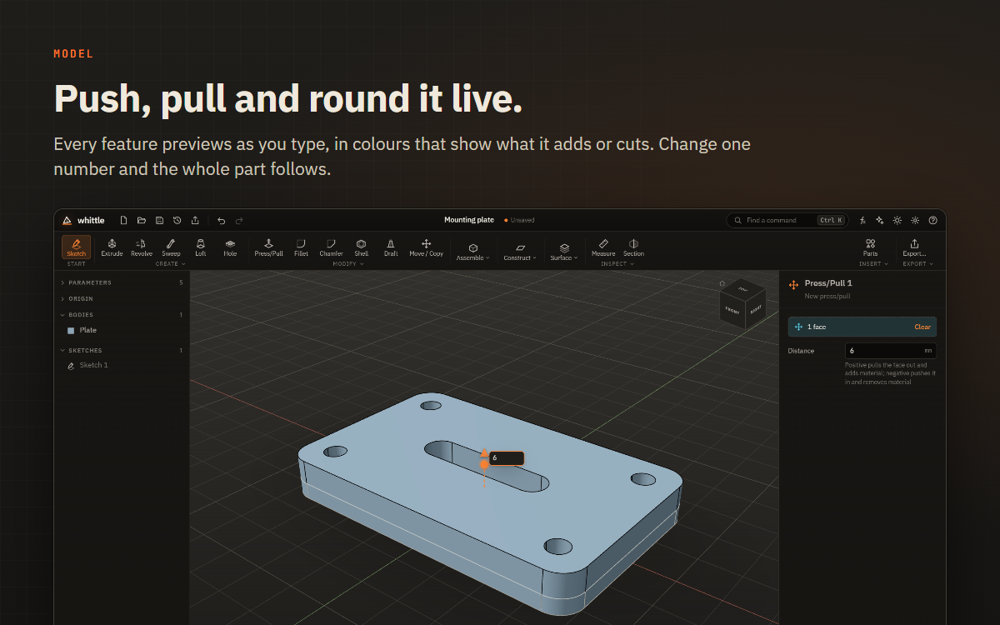
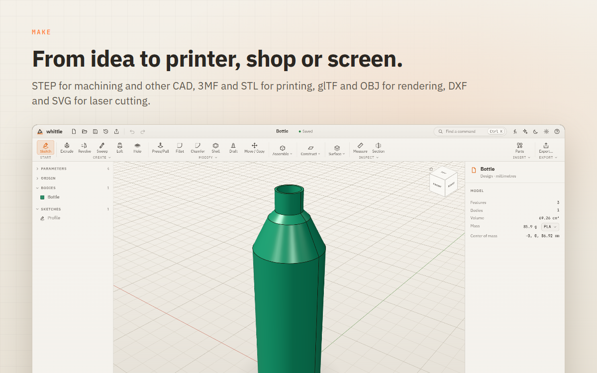
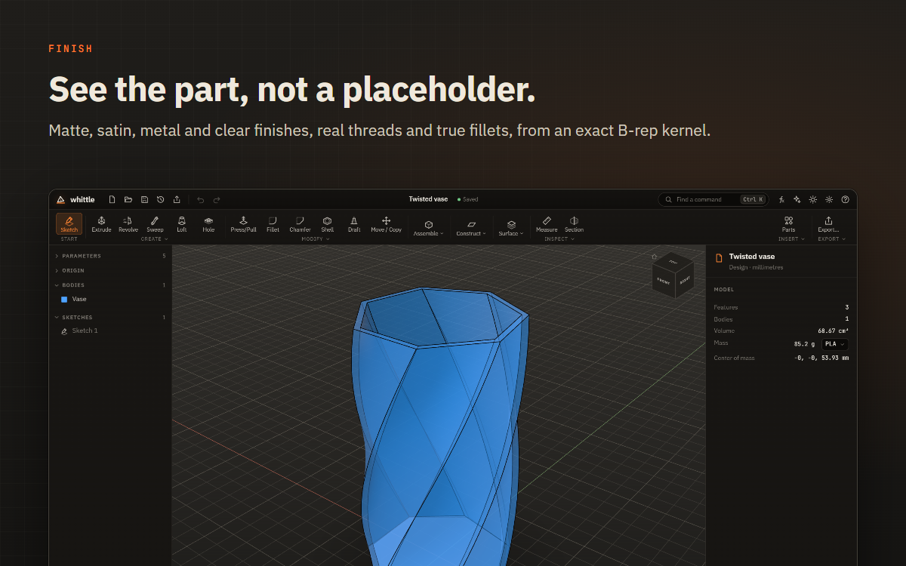
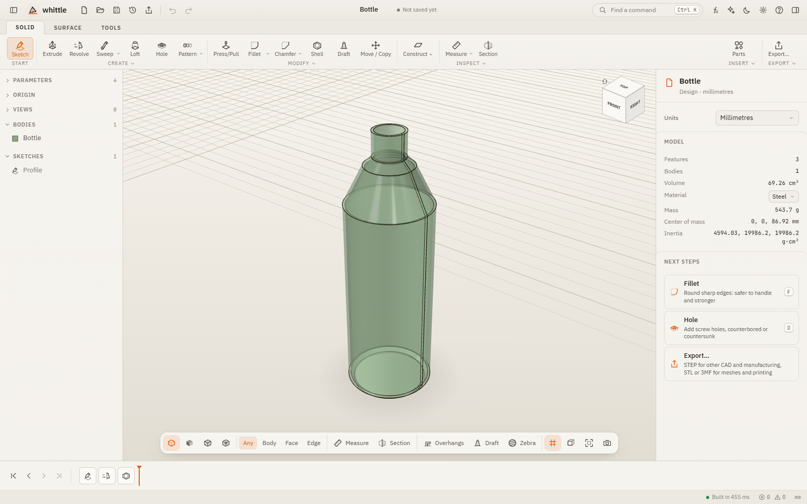

<p align="center">
  
</p>

<p align="center">
  <a href="https://github.com/anand34577/whittle/releases/latest"><b>Download</b></a> ·
  <a href="docs/WHITTLE.md"><b>User guide</b></a> ·
  <a href="https://github.com/anand34577/whittle/wiki"><b>Wiki</b></a> ·
  <a href="docs/SELF_HOSTING.md"><b>Self-hosting</b></a> ·
  <a href="CONTRIBUTING.md"><b>Contributing</b></a>
</p>

# Whittle

**Open-source parametric 3D CAD for everyone: first-timers, makers, product designers, engineers, teachers and students.**

Sketch a shape, give it depth, round the edges, export it. Whittle runs as a desktop app on Windows, macOS and
Linux, on your own server for a team, family or classroom, or in any modern browser.

Under the hood is a real CAD kernel ([OpenCascade](https://dev.opencascade.org/)), so you get exact solids, true
fillets and real threads, not approximate meshes. On top of it is an interface built to be learned in an afternoon:
the next step is always on screen, every number accepts a formula, and when something can't be built, Whittle says
why and suggests a fix.

> **Status: 0.14, preview.** Part modelling, sketch constraints, joints between bodies and a one-sheet 2D drawing
> work end to end. Full assemblies (mates, bills of materials), sheet metal and CAM are on the
> [roadmap](PLAN.md#10-roadmap).

<p align="center">
  
</p>

## Why Whittle

<table>
  <tr>
    <td width="50%"></td>
    <td width="50%"></td>
  </tr>
  <tr>
    <td width="50%"></td>
    <td width="50%"></td>
  </tr>
</table>

- **Guided from the first click.** A short first-run question tunes the workspace to you. A hint line always shows the next step, tools that can't run yet say what they need, and a guided first part walks you through sketch, extrude and fillet.
- **Precise when it matters.** Type exact sizes while you draw, constrain sketches, drive everything from named parameters and formulas such as `width / 2 + 3 mm`. Change one number and the whole part follows.
- **Live, visual feedback.** Every feature previews as you edit it: blue for a new body, green where it adds material, red where it cuts. Drag the on-canvas arrows or type a value; the model updates as you go.
- **Nothing is lost.** Unlimited undo, autosave, crash recovery and a version history with restore, on every platform.
- **Yours to keep.** Free and open source under MPL-2.0. No account, no telemetry, works fully offline (the web app too, once opened). The desktop app checks once a day for a new version; switch that off in Settings.

## Install

| System | One line |
|---|---|
| **Windows** (PowerShell) | `irm https://raw.githubusercontent.com/anand34577/whittle/main/install.ps1 \| iex` |
| **macOS, Linux** (Terminal) | `curl -fsSL https://raw.githubusercontent.com/anand34577/whittle/main/install.sh \| sh` |
| **Server** (Linux x86_64/arm64, bare metal or LXC) | `curl -fsSL https://raw.githubusercontent.com/anand34577/whittle/main/install.sh \| sh -s -- --server` |
| **Server** (Docker) | `docker run -d --name whittle -p 8080:8080 -v whittle-data:/data --restart unless-stopped ghcr.io/anand34577/whittle:latest` |

Prefer a regular installer? Download `.msi`/`.exe`, `.dmg` or `.AppImage`/`.deb`/`.rpm` from the
[latest release](https://github.com/anand34577/whittle/releases/latest).

To **upgrade**, run the same line again. The server backs itself up first and rolls back if the new version doesn't
start. To **uninstall**, add `--uninstall` (macOS and Linux; `--server --uninstall [--purge]` for the server), or on
Windows set `$env:WHITTLE_ACTION="uninstall"` before the PowerShell line.

Step-by-step guides, configuration, single sign-on and troubleshooting are in the
**[wiki](https://github.com/anand34577/whittle/wiki)**.

## Three ways to run it

| | Desktop app | Self-hosted server | Web (static) |
|---|---|---|---|
| **Best for** | one person, offline | teams, families, classrooms, several devices | trying it out, embedding |
| **Sign-in** | none | none, local accounts, single sign-on (OIDC), or both | none |
| **Files** | ordinary `.whittle` files anywhere on disk, native dialogs, recent files, double-click to open | a personal design library with thumbnails | browser file access or downloads |
| **Version history** | every save keeps the previous copy on your computer | every save is a version on the server, with restore | every save keeps a copy in the browser |
| **Get it** | [Installation guide](https://github.com/anand34577/whittle/wiki/Installation) | [Self-hosting guide](https://github.com/anand34577/whittle/wiki/Self-Hosting), [Docker](https://github.com/anand34577/whittle/wiki/Docker) | `npm run build`, then serve `apps/web/dist` |

## What you can do

**Sketch**
- Draw on the origin planes (offset or tilted) or on any flat face: lines and outlines, open paths, rectangles, circles, ellipses, polygons, slots, splines, text and involute spur gears.
- Type exact sizes while drawing. Snapping to points, centers, the grid and alignments.
- Shapes inside shapes become holes automatically, or click just the areas you want to extrude (only the inner circle, only the ring).
- Constrain and dimension: coincident, horizontal, vertical, parallel, perpendicular, tangent, equal, symmetric and more, with formulas in every dimension. Trim, extend, fillet and chamfer sketch corners.
- Duplicate, mirror, rotate, and copy shapes around a circle or in a row.
- Bring in artwork: SVG logos and lettering, DXF drawings, or a photo to trace.

**Create**
- Extrude (one side, symmetric or two distances; taper and twist; new body, join, cut or intersect), revolve, loft, sweep along a path.
- Coils and screw threads, ribs and webs, emboss and engrave.
- Holes: simple, counterbore and countersink, with ISO metric and UNC clearance, tap-drill and heat-set insert sizes.
- Quick box, cylinder, sphere, cone, torus and tube.
- A parts library: spur gear, hex nut, washer, standoff, L bracket, mounting plate, enclosure and lid, knob, name tag, vase and pulley, each inserted as ordinary, editable features.

**Modify**
- Press/pull faces, fillet and chamfer (click edges, a face, or round everything at once), shell, draft, split, offset, scale.
- Move, rotate and copy bodies; combine them (join, cut, keep the overlap); mirror; linear and circular patterns.
- Joints between bodies, and an interference check.

**Understand the design**
- A timeline of every step: edit, suppress, roll back, drag to reorder (Whittle refuses moves that would break the design, and says why).
- Fillets stay on their edges when an earlier sketch changes.
- Measure distances, gaps, angles, diameters, lengths and areas; section views; overhang, draft-angle and zebra-stripe analysis; volume, area and mass for 30 materials.

**Share and make**

| Format | For |
|---|---|
| **STEP** | Other CAD apps, CNC machining and manufacturers (exact geometry) |
| **3MF**, **STL** | 3D printing, with Draft, Standard or Fine mesh detail |
| **glTF (GLB)**, **OBJ** | The web, AR, game engines and rendering |
| **PLY** | Scanning and mesh analysis |
| **SVG**, **DXF** | Any sketch, true size, for laser and vinyl cutters, plotters and CAM |
| **2D drawing (SVG)** | Four views on an A3 sheet with hidden lines, dimensions and a title block |

Import STEP and STL models, and SVG or DXF into sketches. Save a high-resolution image of any view.

**Make it yours**
- Six themes plus *match system*, seven accent colors, density, interface size and reduced motion.
- Matte, satin, metal and clear finishes for every body.
- Mouse layouts for the common CAD conventions, and two keyboard layouts.

**AI assistant (optional)**
- Describe a part or a change, and the assistant builds it with Whittle's own tools, as editable, undoable features.
- Bring your own model: a hosted provider with your API key, or a local model on your own computer. The same [design API](docs/AI_INTEGRATION.md) is open to scripts.

**Self-hosted server**
- Accounts with email and password reset, single sign-on with account linking and merging.
- An administration console: people, invitations, SMTP email, notifications and an activity log.
- `backup`, `restore`, `migrate-db` and `doctor` commands.

<p align="center">
  
</p>

## Keyboard

| | |
|---|---|
| **Model** | `S` sketch · `E` extrude · `R` revolve · `D` hole · `F` fillet · `Q` press/pull · `M` move · `J` combine · `I` measure · `P` parts library |
| **View** | `H` home view · `Shift+H` fit · right-click for quick actions |
| **Sketch** | `L` line · `A` path · `R` rectangle · `C` circle · `E` ellipse · `P` polygon · `O` slot · `T` text · `G` gear · `V` select · `X` construction · `Ctrl+D` duplicate · `Shift+R` rotate |
| **Everywhere** | `Ctrl+K` find any command · `Ctrl+I` AI assistant · `Ctrl+,` settings · `Ctrl+S` save · `Ctrl+Z` undo · `Esc` cancel or finish · `?` every shortcut |

Used to different keys? **Settings → Navigation** switches to the classic CAD letters (`H` hole, `J` joint, `Home`
home view; in a sketch `T` trim, `O` offset, `P` project) and offers mouse layouts that orbit with the middle or right
button. Menus, tooltips and the `?` list always show the keys of the layout you chose.

## Build from source

```bash
npm install
npm run dev          # http://localhost:5173
```

| Command | What it does |
|---|---|
| `npm run dev` | Web app with hot reload |
| `npm run build` | Production web build → `apps/web/dist` |
| `npm test` | Unit and geometry tests (runs the real OpenCascade kernel in Node) |
| `npm run typecheck` | TypeScript, strict |
| `node tests/e2e/smoke.mjs <url>` | Browser test of the core flow (also `features.mjs`, `advanced.mjs`, `modeling.mjs` and more in `tests/e2e`, and `server.mjs` against a server) |
| `cd apps/server && cargo test` | Server API tests (SQLite; set `WHITTLE_TEST_DATABASE_URL` for PostgreSQL) |

**Desktop app (Tauri 2).** Needs Rust and the platform toolchain ([Tauri prerequisites](https://tauri.app/start/prerequisites/));
on Windows that means Visual Studio with the *Desktop development with C++* workload.

```bash
cd apps/desktop
npx tauri dev        # development window
npx tauri build      # installers for this OS
```

**Self-hosted server.**

```bash
npm run build
cargo run --release --manifest-path apps/server/Cargo.toml   # http://localhost:8080, SQLite in ./data
```

Bare metal, LXC, Docker, PostgreSQL, single sign-on, reverse proxies and backups are covered in
**[docs/SELF_HOSTING.md](docs/SELF_HOSTING.md)**.

## Releases

Push a tag such as `v0.9.0` and [`release.yml`](.github/workflows/release.yml) builds and publishes desktop installers
for Windows x64, macOS (universal), Linux x64 and arm64; static server builds for Linux x86_64 and aarch64 with an
installer; a multi-arch Docker image on GHCR; and `SHA256SUMS`. See [CONTRIBUTING.md](CONTRIBUTING.md#releasing).

## Repository layout

```
packages/core     Document model, unit-aware formulas, undo history, file format (.whittle)
packages/kernel   Geometry: OpenCascade (WASM) in a Web Worker, rebuild engine, persistent references, exporters
apps/web          The app: React UI, Three.js viewport, sketch tools, design system, platform layer
apps/desktop      Tauri 2 shell (Rust): native files, dialogs, recent files, local version history
apps/server       Rust/Axum server: accounts (none / local / OIDC), design storage with versions, SQLite or PostgreSQL
deploy            systemd and OpenRC services, settings template, installer, release Dockerfile
docs              User guide, architecture, self-hosting, design API, and the images in this README
tests/e2e         Browser tests for the core flow, tools, sketching, constraints, pictures and the server
```

[docs/ARCHITECTURE.md](docs/ARCHITECTURE.md) explains how it fits together, [PLAN.md](PLAN.md) holds the product
plan, and [docs/AI_INTEGRATION.md](docs/AI_INTEGRATION.md) documents the design API.

## Contributing

Bug reports, ideas and pull requests are welcome. [CONTRIBUTING.md](CONTRIBUTING.md) covers the setup, the tests to
run before a pull request, and how releases are cut.

## License

Whittle is released under the [Mozilla Public License 2.0](LICENSE). Third-party components and their licenses are
listed in [THIRD_PARTY_LICENSES.md](THIRD_PARTY_LICENSES.md).

All product names and trademarks mentioned in this project belong to their respective owners. Whittle is an
independent project and is not affiliated with, endorsed by or sponsored by any other CAD vendor.
